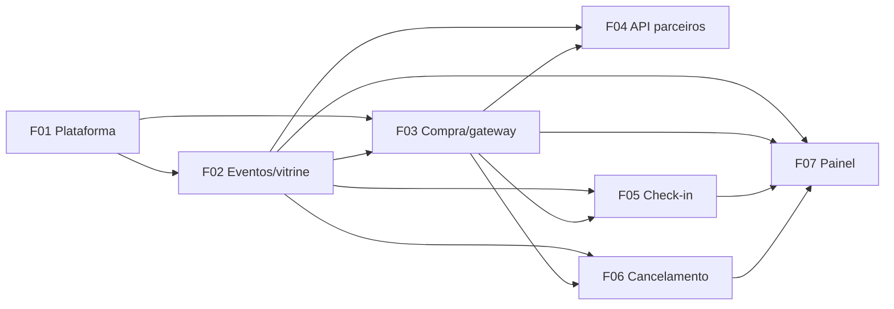

# PRD — Catraca (MVP)

> Fonte: brief da fundadora (regras R01–R13, gateway simulado, contrato fixo da API de parceiros).
> Este PRD divide o produto em features com IDs, declara o que cada uma **provê** e **consome**,
> define o grafo de dependências, as waves e os critérios de aceite — inclusive os **cross-feature (X)**,
> que provam que o que uma feature provê chega e funciona na que consome.

## 1. Visão

A Catraca vende ingressos para eventos pequenos. Organizadores (vindos da seed) criam e operam eventos;
participantes criam conta, compram e veem seus ingressos; parceiros vendem pela API com uma chave.
O pagamento passa por um gateway externo **simulado** que responde de forma assíncrona.

A tentativa anterior falhou na **junção** das features (evento cancelado deixando entrar, estorno somado
como receita, overbooking sob concorrência). Por isso, neste PRD:

- existe **uma única fonte de verdade** para cada conceito compartilhado (vagas de R05, status de ingresso,
  posse do evento), provida por uma feature e consumida pelas outras — nunca reimplementada;
- cada aresta do grafo tem critério cross-feature verificável.

## 2. Atores

| Ator | Como entra | O que faz |
|---|---|---|
| Visitante | sem login | vê a vitrine (`/`) e a página pública do evento |
| Participante | cadastro próprio (nome, e-mail, senha) | entra, sai, compra, vê "Meus ingressos" |
| Organizador | conta da seed (sem cadastro) | área `/organizer`: cria, edita, publica, cancela, faz check-in, vê painel dos **próprios** eventos |
| Parceiro | header `X-Api-Key` | `/api/partner/*` (contrato fixo) |

## 3. Modelo de domínio (resumo)

- **Evento**: `id` (`evt_…`), `organizer_id`, nome, `starts_at`, local, `capacity` (int ≥ 1), `price_cents` (> 0),
  `status` ∈ {`draft`, `published`, `cancelled`}. Nasce `draft` (R02). `cancelled` é terminal (R11).
- **Ingresso**: `id` (`tkt_…`), `event_id`, `code` (8 chars, único — R09), `status` ∈ {`pending`, `confirmed`,
  `declined`, `cancelled`, `refunded`}, `price_cents` (preço vigente na compra — R03/R12), `channel` ∈ {`web`, `api`},
  `user_id` (nulo para API), `buyer_email`, `checked_in_at` (nulo = não fez check-in; API: `checkedIn`).
- **Rótulos** de status na UI: pendente, confirmado, recusado, cancelado, estornado.
- **Vagas ocupadas** = ingressos `pending` + `confirmed`. **Vagas disponíveis** = `capacity − ocupadas`; `0` se `cancelled` (R05).

## 4. Features

| ID | Nome | Wave | Regras |
|---|---|---|---|
| F01 | Plataforma e contas | 1 | R13 (papéis) |
| F02 | Eventos e vitrine | 2 | R01, R02, R03, R04, R05, R13 |
| F03 | Compra e gateway | 3 | R03 (preço), R05, R06, R07, R08, R09 |
| F04 | API de parceiros | 4 | R02, R05, R06, R07 |
| F05 | Check-in | 4 | R10, R13 |
| F06 | Cancelamento | 4 | R11 |
| F07 | Painel do evento | 5 | R12 |

### F01 — Plataforma e contas
**Provê**
- `P01.1` Sessão por cookie e `request.user` (`{id, name, email, role}`), `role` ∈ {`organizer`, `participant`}.
- `P01.2` Guardas `requireOrganizer` / `requireParticipant` (visitante → redireciona para `/login`; papel errado → 403 sem dados).
- `P01.3` Cadastro de participante, login, logout. Organizador não se cadastra.
- `P01.4` Seed idempotente: organizador A, organizador B, participante.
- `P01.5` Layout HTML comum (`layout()`, `html`/`escapeHtml`) com navegação por papel.

**Consome**: — (apenas o harness: `pool`, `withTransaction`, migrations).

### F02 — Eventos e vitrine
**Provê**
- `P02.1` Tabelas `events` e `tickets` (o ingresso é inventário do evento; F03 cria as linhas).
- `P02.2` Módulo de vagas `seats` (R05): `occupiedSeats(eventId)`, `availableSeats(event)` — **única** implementação de R05.
- `P02.3` Consultas `listOnSaleEvents()` / `getOnSaleEvent(id)` (publicado e não cancelado — R02).
- `P02.4` Área do organizador: `/organizer` (lista dos próprios eventos), criar, editar, publicar.
- `P02.5` Página de gestão `/organizer/events/:id` (R04) com **registro de seções** (`registerManagementSection`) onde
  check-in, cancelamento e painel se plugam, e `loadOwnedEvent()` que responde 404 sem dados para não-donos (R13).
- `P02.6` Vitrine `/` e página pública `/events/:id` com **slot de compra** preenchido por F03.

**Consome**: `P01.1`, `P01.2`, `P01.5`.

### F03 — Compra e gateway
**Provê**
- `P03.1` Serviço `purchaseTicket({eventId, buyerEmail, cardNumber, userId, channel})` com validação na ordem
  `invalid_request → event_not_available → sold_out`, reserva atômica (R07) e resposta sem esperar o gateway (R06).
- `P03.2` Gateway simulado (finais 0001–0004) com resposta assíncrona e `applyGatewayResult()` que **só altera ingressos
  `pending`** (garantia consumida por F06 para R11).
- `P03.3` Snapshot do preço no ingresso (`tickets.price_cents`) — R03/R12.
- `P03.4` Compra na vitrine (formulário de cartão), mensagem **Ingressos esgotados**, "Meus ingressos" (R09).
- `P03.5` `getTicketById()`, `findTicketByCode()`, rótulos de status.

**Consome**: `P01.1`, `P01.2`, `P02.1`, `P02.2`, `P02.3`, `P02.6`.

### F04 — API de parceiros
**Provê**: `GET /api/partner/events`, `POST /api/partner/events/:id/purchases`, `GET /api/partner/tickets/:id`
(contrato fixo do brief), autenticação `X-Api-Key`.

**Consome**: `P02.2`, `P02.3`, `P03.1`, `P03.5`.

### F05 — Check-in
**Provê**: seção de check-in na página de gestão e `POST /organizer/events/:id/checkin` com as cinco mensagens de R10;
marca `tickets.checked_in_at` de forma atômica.

**Consome**: `P02.5`, `P03.5`.

### F06 — Cancelamento
**Provê**: `cancelEvent(eventId, organizerId)` e botão na página de gestão. Na mesma transação: evento `cancelled`,
`confirmed → refunded`, `pending → cancelled`. Evento cancelado não aparece, não vende e não é editável/republicável.

**Consome**: `P02.1`, `P02.3`, `P02.5`, `P03.2` (garantia "gateway só altera `pending`").

### F07 — Painel do evento
**Provê**: seção "Painel" na página de gestão com Confirmados, Pendentes, Check-ins, Vagas disponíveis, Receita, Estornados.

**Consome**: `P02.2`, `P02.5`, `P03.3`, dados de check-in de F05 (`checked_in_at`), status `refunded` de F06.

## 5. Grafo de dependências e waves

Arestas (provedor → consumidor) e o critério cross-feature que cobre cada uma:

| Aresta | Critério X |
|---|---|
| F01 → F02 | X01 |
| F01 → F03 | X02 |
| F02 → F03 | X03, X04 |
| F02 → F04 | X05 |
| F03 → F04 | X06, X07 |
| F02 → F05 | X08 |
| F03 → F05 | X09 |
| F02 → F06 | X10 |
| F03 → F06 | X11 |
| F02 → F07 | X12 |
| F03 → F07 | X13 |
| F05 → F07 | X14 |
| F06 → F07 | X15 |

| Wave | Features | Execução |
|---|---|---|
| 1 | F01 | sequencial |
| 2 | F02 | sequencial |
| 3 | F03 | sequencial |
| **4** | **F04, F05, F06** | **paralela** — 3 branches/worktrees simultâneas, integradas por PRs |
| 5 | F07 | sequencial |

A wave 4 é paralelizável porque F04, F05 e F06 só consomem F02/F03 (já na main) e não consomem umas das outras.
Pontos de conflito esperados: `src/app.ts` (registro de plugins) e os registros de seção da página de gestão — resolvidos no merge.

## 6. Critérios de aceite

Convenção: `Fxx-ACn` = critério da feature; `Xnn` = cross-feature; `H*` = harness. Cada critério cita a(s) regra(s).

### Harness (coberto pelo contrato de F01)
- **H1** Em clone limpo, `bash scripts/up.sh` deixa o produto em `http://localhost:3000` com a seed carregada, sem outro passo.
- **H2** `bash scripts/down.sh` encerra tudo (nenhuma porta responde, nenhum container do projeto); subir de novo funciona, inclusive a seed.
- **H3** `bash scripts/gates.sh` roda typecheck e testes automatizados e passa.
- **H4** Modo padrão usa gateway simulado sem nenhuma chave de pagamento.
- **H5** `AGENTS.md` tem comandos e mapa dos artefatos; `CLAUDE.md` aponta para ele.

### F01 — Plataforma e contas
- **F01-AC1** Visitante cria conta de participante com nome, e-mail e senha; fica logado. E-mail repetido ou campos inválidos são rejeitados com mensagem.
- **F01-AC2** Login com credenciais válidas (seed ou cadastro) funciona; senha errada é rejeitada; logout encerra a sessão.
- **F01-AC3** (R13) Visitante em `/organizer` é redirecionado para `/login`; participante recebe 403 sem dados de organizador; organizador da seed acessa.
- **F01-AC4** A seed cria organizador A, organizador B e participante; rodar a seed de novo não dá erro nem duplica contas.
- **F01-AC5** Não existe caminho no produto que crie conta de organizador (o cadastro sempre cria participante).

### F02 — Eventos e vitrine
- **F02-AC1** (R01) Criar evento exige nome, data/hora de início, local, lotação inteira ≥ 1 e preço > 0 (em reais, ex.: `100,00`); valores inválidos são rejeitados com mensagem.
- **F02-AC2** (R01) Data de início no passado é rejeitada ao criar e ao editar.
- **F02-AC3** (R02) Evento nasce rascunho: não aparece em `/` e `/events/:id` responde 404; após publicar, aparece na vitrine.
- **F02-AC4** (R03, R05) Reduzir a lotação abaixo das vagas ocupadas (pendentes + confirmados) é rejeitado; aumentar é aceito.
- **F02-AC5** (R04) Cada evento tem página de gestão em `/organizer/events/:id` com editar e publicar; a lista `/organizer` linka para ela.
- **F02-AC6** (R13) Organizador B não vê eventos de A em `/organizer` e, em `/organizer/events/<id de A>` (GET ou POST de editar/publicar), recebe 404 sem nome, números ou ingressos de A; o evento não muda.
- **F02-AC7** (R05) `availableSeats` = lotação − (pendentes + confirmados), e 0 para evento cancelado (testes unitários do módulo `seats`).
- **X01** (F01→F02; R13) As rotas de F02 sob `/organizer` usam as guardas de F01: visitante → `/login`, participante → 403, organizador da seed → acesso apenas aos próprios eventos.

### F03 — Compra e gateway
- **F03-AC1** (R06) Participante logado compra na página do evento com cartão de 16 dígitos; a resposta chega sem esperar o gateway e o ingresso nasce `pendente`.
- **F03-AC2** (R08) Final 0001 → `confirmado` em 2–5 s; 0002 → `recusado` em 2–5 s; 0003 → aprovado em 30–40 s; 0004 → recusado em 30–40 s; outro final → recusado em 2–5 s.
- **F03-AC3** Cartão fora de 16 dígitos é rejeitado antes de criar ingresso (nenhuma linha nova).
- **F03-AC4** (R05, R06, R08) Ingresso pendente ocupa vaga até a resposta; recusa libera a vaga.
- **F03-AC5** (R07) Sem vaga, a página do evento exibe **Ingressos esgotados** no lugar da compra, e uma tentativa de compra responde **Ingressos esgotados**.
- **F03-AC6** (R07) Sob compras simultâneas, vagas ocupadas nunca passam da lotação: 30 compras paralelas em evento de lotação 5 → exatamente 5 sucessos, repetido em várias rodadas (teste automatizado).
- **F03-AC7** (R09) Cada ingresso tem código único de 8 caracteres; "Meus ingressos" mostra evento, status (rótulo) e código apenas dos ingressos do próprio participante.
- **F03-AC8** (R03) O ingresso guarda o preço vigente na compra; mudar o preço do evento não altera ingressos já comprados.
- **F03-AC9** (R08, R11) `applyGatewayResult` só altera ingresso `pending`; resultado para ingresso em outro status é ignorado.
- **X02** (F01→F03) Comprar exige sessão de participante (visitante → `/login`); "Meus ingressos" usa `request.user` de F01.
- **X03** (F02→F03; R02) Só evento publicado e não cancelado aceita compra (rascunho → não disponível); o formulário de compra aparece no slot da página pública de F02.
- **X04** (F02→F03; R03, R05) Compras de F03 entram nas vagas do módulo `seats` de F02: com 1 pendente + 1 confirmado, reduzir a lotação para 1 é rejeitado pela edição de F02.

### F04 — API de parceiros
- **F04-AC1** Sem `X-Api-Key` ou com chave inválida, as três rotas respondem 401 `{"error":"unauthorized"}`.
- **F04-AC2** (R02) `GET /api/partner/events` lista só publicados e não cancelados com exatamente `id`, `name`, `startsAt` (ISO 8601 com offset), `priceCents`, `availableSeats`.
- **F04-AC3** (R06) `POST /api/partner/events/:id/purchases` válido responde 202 `{ticketId, code, status:"pending"}` sem esperar o gateway.
- **F04-AC4** Erros na ordem: corpo inválido (faltando campo, e-mail mal formado, cartão ≠ 16 dígitos) → 422 `invalid_request`; evento inexistente/rascunho/cancelado → 404 `event_not_available`; sem vaga → 409 `sold_out`.
- **F04-AC5** (R07) 30 compras simultâneas via HTTP em evento novo de lotação 5 → exatamente 5×202 e 25×409, em pelo menos duas rodadas.
- **F04-AC6** `GET /api/partner/tickets/:id` responde 200 `{ticketId, code, eventId, status, checkedIn}`; inexistente → 404 `ticket_not_found`.
- **X05** (F02→F04; R02, R05) A listagem usa `listOnSaleEvents`/`availableSeats` de F02: rascunho fora, publicado dentro, `availableSeats` reflete vendas da vitrine.
- **X06** (F03→F04; R06, R08) Compra pela API passa por `purchaseTicket` de F03: com 0001 fica `confirmed` em ≤ 5 s; com 0004 fica `declined` após 30–40 s e libera vaga.
- **X07** (F03→F04; R09) A consulta da API retorna ingressos comprados na vitrine com o mesmo `code` mostrado em "Meus ingressos".

### F05 — Check-in
- **F05-AC1** (R10) Na página de gestão, o organizador informa um código; a primeira condição verdadeira define a mensagem exata: `Ingresso inválido para este evento`, `Evento cancelado`, `Ingresso não confirmado`, `Ingresso já utilizado`, `Entrada liberada`.
- **F05-AC2** (R10) Check-in liberado marca o ingresso (`checkedIn: true` na API); o mesmo código depois → `Ingresso já utilizado`; check-ins simultâneos do mesmo código liberam no máximo uma entrada.
- **X08** (F02→F05; R04, R13) O check-in aparece como seção da página de gestão de F02 e usa `loadOwnedEvent`: B não faz check-in em evento de A (404, sem dados).
- **X09** (F03→F05; R10) Ingressos criados por F03 (vitrine e API) funcionam no check-in: confirmado → `Entrada liberada`; pendente → `Ingresso não confirmado`; código de outro evento → `Ingresso inválido para este evento`.

### F06 — Cancelamento
- **F06-AC1** (R11) Organizador cancela evento publicado pela página de gestão; o cancelamento é irreversível (não há republicar).
- **F06-AC2** (R11) Ao cancelar, em até 10 s: `confirmed → refunded`, `pending → cancelled`.
- **F06-AC3** (R11) Resposta do gateway que chega depois do cancelamento não muda o status (cancelled/refunded permanecem).
- **F06-AC4** (R11) Evento cancelado não pode ser editado nem publicado (formulário some e POST é rejeitado); a página de gestão mostra que está cancelado.
- **X10** (F02→F06; R02, R11) Evento cancelado some da vitrine (`/`) e a página pública não oferece compra; edição de F02 o rejeita; `availableSeats` = 0.
- **X11** (F03→F06; R11) `purchaseTicket` recusa evento cancelado (vitrine e API: `event_not_available`) e a garantia de `applyGatewayResult` mantém `cancelled`/`refunded` após resposta tardia (cartão 0003).

### F07 — Painel do evento
- **F07-AC1** (R12) A página de gestão mostra o painel com os rótulos exatos: Confirmados, Pendentes, Check-ins, Vagas disponíveis, Receita, Estornados.
- **F07-AC2** (R12) Confirmados inclui os que fizeram check-in; Check-ins conta confirmados com check-in; Receita soma o preço pago dos confirmados, formatada `R$ 350,00`; Estornados conta `refunded`.
- **X12** (F02→F07; R05, R13) "Vagas disponíveis" vem de `availableSeats` de F02 e o painel só aparece para o dono do evento.
- **X13** (F03→F07; R03, R12) Receita usa o preço gravado em cada ingresso: 2 confirmados a R$ 100,00 + 1 a R$ 150,00 → R$ 350,00; vendas da vitrine e da API contam igual.
- **X14** (F05→F07; R12) Após um check-in liberado, Check-ins passa de 0 para 1 e Confirmados não muda.
- **X15** (F06→F07; R11, R12) Após cancelar evento com 1 confirmado e 1 pendente: Confirmados 0, Pendentes 0, Vagas 0, Receita R$ 0,00, Estornados 1.

### Rastreabilidade das regras

| Regra | Critérios |
|---|---|
| R01 | F02-AC1, F02-AC2 |
| R02 | F02-AC3, F04-AC2, X03, X05, X10 |
| R03 | F02-AC4, F03-AC8, X04, X13 |
| R04 | F02-AC5, X08 |
| R05 | F02-AC4, F02-AC7, F03-AC4, X04, X05, X12 |
| R06 | F03-AC1, F03-AC4, F04-AC3, X06 |
| R07 | F03-AC5, F03-AC6, F04-AC5 |
| R08 | F03-AC2, F03-AC4, F03-AC9, X06 |
| R09 | F03-AC7, X07 |
| R10 | F05-AC1, F05-AC2, X09 |
| R11 | F03-AC9, F06-AC1..AC4, X10, X11, X15 |
| R12 | F07-AC1, F07-AC2, X13, X14, X15 |
| R13 | F01-AC3, F02-AC6, X01, X08, X12 |

## 7. Fora de escopo

- Deploy e qualquer ambiente além do local.
- Gateway de pagamento real, e-mail e notificações.
- App mobile e qualidade visual (HTML server-side simples).
- Cadastro de organizador pelo produto.
- Mais de um ingresso por compra, mapa de assentos, cancelamento ou transferência pelo participante.
- Atualização em tempo real (recarregar a página basta).
- Fuso horário configurável: datas dos formulários são interpretadas em `-03:00` (Brasília).
- Recuperação de senha, edição de perfil, paginação, busca.
- Reembolso real no gateway: "estornado" é só status.
